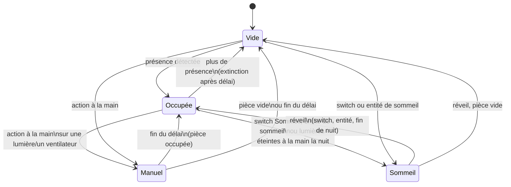

# Lumina

Intégration Home Assistant de gestion automatique des lumières, ventilateurs et clims **par pièce**, avec prise en compte de la présence, de la luminosité et de la température.

Chaque pièce est une entrée de configuration indépendante, ajoutée depuis l'interface : aucune automatisation à écrire ou à dupliquer.

Pour suivre et piloter une pièce depuis un tableau de bord, voir la carte [Lumina Card](#carte).

## Fonctionnement



- **Présence** : la pièce n'est considérée vide qu'après un court délai sans détection (30 s par défaut). Une micro-coupure du détecteur n'éteint donc rien et ne lève pas le contrôle manuel. Les délais d'extinction restent comptés depuis la fin réelle de présence. Un détecteur indisponible (redémarrage de Zigbee2MQTT…) ne vide pas la pièce : l'occupation en cours est gardée jusqu'à ce qu'il réponde de nouveau.
- **Lumières** : allumées à l'arrivée si la luminosité est sous le seuil (toujours, s'il n'y a pas de capteur de luminosité). Si le capteur choisi ne répond pas, Lumina se fie au soleil (`sun.sun`) : allumage seulement s'il est couché. Éteintes quand la pièce est vide depuis le délai réglé.
- **Ventilateurs** : allumés quand la pièce est occupée et que la température atteint le seuil, arrêtés 1 °C en dessous (hystérésis), avec au moins 5 min entre deux bascules dues à la température. Sans capteur de température, ils suivent simplement la présence.
- **Contrôle manuel** : allumer ou éteindre une lumière ou un ventilateur à la main suspend l'automatisme de ce groupe pendant la durée réglée. Plusieurs changements en moins de 5 s (deux lampes, extinction + vitesse) comptent pour un seul geste. Un appareil lent (cloud, clim) qui confirme une commande de Lumina jusqu'à 1 min plus tard ne compte pas comme un geste manuel. La reprise manuelle est levée dès que la pièce est confirmée vide. En [sommeil](#sommeil), un geste tient jusqu'au réveil. Un contrôle manuel en cours survit à un redémarrage de Home Assistant.

### Mode nuit

Chaque pièce a sa propre plage de nuit (22 h → 7 h par défaut) avec ses réglages dédiés :

- **Luminosité des lumières** : 30 % la nuit, 100 % le jour par défaut. À **0 %**, les lumières ne s'allument plus automatiquement la nuit (pratique dans une chambre d'enfants).
- **Délais d'extinction** propres à la nuit. Celui des ventilateurs est long par défaut (30 min), car un détecteur PIR ne voit pas une personne endormie immobile.
- **Seuil de température** de nuit (26 °C par défaut).

Mettre la même heure en début et en fin de nuit désactive le mode nuit pour la pièce. La période en cours (jour/nuit) apparaît en attribut du capteur d'état.

Le switch **Nuit maintenant** force le mode nuit tout de suite ; il se désactive seul à la prochaine heure de fin de nuit, même si la pièce n'a pas de plage de nuit.

### Sommeil

La nuit, Lumina distingue une pièce où l'on est éveillé (aller boire un verre à 2 h : lumière faible et chaude, extinction rapide) d'une pièce où l'on dort. Une pièce en sommeil :

- **n'allume pas les lumières**, sauf une veilleuse si la **Luminosité en sommeil** est réglée au-dessus de 0 % ;
- **garde les gestes manuels jusqu'au réveil** : la lumière éteinte au coucher ne se rallume pas, ni au bout de la durée réglée, ni quand un dormeur que le détecteur ne voyait plus bouge de nouveau. Un allumage à la main garde la durée réglée, pour qu'une lampe allumée dans une pièce vide ne reste pas allumée toute la nuit ;
- **est présumée occupée** pour les ventilateurs et la clim, dès que quelqu'un y a été détecté depuis le coucher : un dormeur immobile que le détecteur ne voit plus ne les arrête pas, et les ventilateurs suivent toujours la température. Un sommeil lancé depuis une autre pièce ne démarre donc rien dans une chambre encore vide ;
- utilise les réglages de nuit (teinte, seuil de température, action sur la clim).

Pendant ce temps, les autres pièces gardent leur comportement : le couloir s'allume doucement quand on se lève, la chambre reste dans le noir.

La pièce passe en sommeil :

- avec le switch **Sommeil**, à toute heure (sieste comprise) ;
- avec une **entité de sommeil**, choisie dans **Configurer** (capteur de lit, téléphone en charge, `input_boolean`…) : active, la pièce s'endort ; inactive, elle se réveille. Choisis une entité stable : se lever quelques minutes ne doit pas la couper ;
- la nuit, quand on éteint **toutes** les lumières à la main (les ventilateurs dans une pièce sans lumière), selon le réglage **Extinction à la main la nuit** :
  - **Contrôle manuel** : pas de sommeil, la durée réglée s'applique ;
  - **Sommeil jusqu'à ce que la pièce se vide** (par défaut, pour un salon) : on y revient éclairé après l'avoir quittée, mais un dormeur que le détecteur perd réveille aussi la pièce ;
  - **Sommeil jusqu'au réveil, pièce présumée occupée** (pour une chambre) : le dormeur perdu par le détecteur ne rallume rien.

  Seul un geste compte (interrupteur, appli, voix) : une extinction par une automatisation ou un script, comme une scène « tout éteindre » en partant, n'endort pas la pièce. Pour un bouton « bonne nuit » qui passe par une automatisation, fais-lui activer le switch **Sommeil**.

Elle se réveille quand on coupe le switch, quand l'entité de sommeil repasse à `off`, et **toujours à l'heure de fin de nuit**, pour qu'un sommeil oublié ne dure pas. Au réveil de fin de nuit, la lumière reste éteinte tant que la pièce ne s'est pas vidée (ou jusqu'à un geste) : le dormeur qui bouge à 7 h ne s'éclaire pas. Ce qui avait été réglé à la main avant le coucher tient aussi jusqu'au réveil. Changer l'heure de fin de nuit déplace le réveil. Le sommeil survit à un redémarrage de Home Assistant.

### Clims

Lumina n'allume jamais une clim : il agit seulement quand la pièce se vide, et seulement sur une clim qui refroidit ou chauffe (pas en simple ventilation).

- **Pièce vide** : après le délai réglé (15 min par défaut), la clim est éteinte, passée en `eco` ou sa consigne est relevée de 2 °C, selon le réglage du jour et celui de la nuit. La nuit, Lumina ne fait rien par défaut : un détecteur peut ne pas voir un dormeur.
- **Retour dans la pièce** : si quelqu'un revient dans les 2 h, la clim retrouve l'état qu'elle avait (mode, preset ou consigne). Au-delà, elle reste telle quelle.
- **Ventilateurs pendant la clim** : quand une clim refroidit, les ventilateurs suivent la température (par défaut), passent en brassage à vitesse fixe pour répartir le froid, ou s'arrêtent.
- **Contrôle manuel** : changer le mode, la consigne, le preset ou la ventilation de la clim suspend l'automatisme de la clim, comme pour les lumières.

Une clim gérée par Lumina ne peut pas servir de maintien de présence, sinon la pièce ne se viderait jamais.

### Confort

- **Maintien de présence** : une TV, une enceinte (ou une clim non gérée par Lumina) active garde la pièce occupée quand les détecteurs ne voient plus personne (devant la TV sans bouger, par exemple). Le maintien prolonge une présence, il ne la déclenche pas. Une pièce occupée le reste après un redémarrage de Home Assistant tant que le maintien est actif : l'occupation d'avant le redémarrage est reprise, puis levée après la confirmation d'absence si plus rien ne la justifie.
- **Température ressentie** : avec un capteur d'humidité, les ventilateurs suivent l'indice de chaleur (NOAA) plutôt que la température mesurée. 27 °C à 85 % d'humidité se ressentent comme 30 °C.
- **Vitesse progressive** : les ventilateurs démarrent à la vitesse minimale (33 %) au seuil, puis montent jusqu'à 100 % sur l'écart réglé (3 °C). Une vitesse minimale à 0 revient au simple marche/arrêt. Changer la vitesse à la main compte comme une reprise manuelle.
- **Avertissement avant extinction** : les lumières baissent pendant 15 s avant de s'éteindre, à 20 % ou à la moitié de leur luminosité si elle est faible ; une veilleuse presque éteinte s'éteint directement. Un mouvement pendant ce temps rend à chaque lumière la luminosité qu'elle avait avant. Une lumière sans variateur s'éteint directement.
- **Teinte** : 4000 K le jour, 2700 K la nuit, pour les lumières à blanc réglable (0 = ne pas modifier).
- **Journal** : chaque décision apparaît dans le Journal avec sa raison, dans la langue de Home Assistant (français ou anglais), par exemple « allume les lumières à 30 % (nuit, 12 lx) ». Les ajustements de vitesse fréquents sont regroupés (une entrée toutes les 10 min au plus).
- **Lumière du jour** : avec un seuil d'extinction réglé, les lumières s'éteignent quand le capteur mesure au moins cette valeur pendant 5 min. Règle-le **au-dessus** de ce que mesure le capteur lampes allumées, sinon la lampe s'éteindrait d'elle-même. Après une telle extinction, l'allumage automatique ne reprend qu'après 10 min sous le seuil d'allumage, ou quand la pièce se vide.
- **Plusieurs lumières ou ventilateurs** : par défaut, Lumina allume toutes les lumières (ou tous les ventilateurs) éteints de la pièce ; l'option « Seulement si aucune n'est allumée » (« aucun » pour les ventilateurs) respecte un appareil déjà allumé.

Les lumières et ventilateurs peuvent aussi être des prises (`switch`), par exemple un ventilateur branché sur une prise Zigbee.

## Entités créées par pièce

| Entité | Rôle |
|---|---|
| `sensor.<pièce>_lumina_etat_de_la_piece` | Occupée / Vide / Contrôle manuel / En sommeil |
| `switch.…_gestion_auto_des_lumieres` | Active ou suspend l'automatisme des lumières |
| `switch.…_gestion_auto_des_ventilateurs` | Active ou suspend l'automatisme des ventilateurs |
| `number.…_seuil_de_luminosite` | Seuil en lx (défaut 50) |
| `number.…_seuil_de_temperature` | Seuil en °C (défaut 27) |
| `number.…_delai_d_extinction_des_lumieres` | En secondes (défaut 120) |
| `number.…_delai_d_arret_des_ventilateurs` | En secondes (défaut 300) |
| `number.…_duree_du_controle_manuel` | En minutes (défaut 30, 0 pour désactiver) |
| `number.…_confirmation_d_absence` | En secondes (défaut 30, 0 = immédiat) |
| `number.…_luminosite_des_lumieres_jour` | En % (défaut 100) |
| `time.…_debut_de_la_nuit` / `time.…_fin_de_la_nuit` | Plage de nuit (défaut 22:00 → 07:00) |
| `number.…_luminosite_des_lumieres_nuit` | En % (défaut 30, 0 = pas d'allumage la nuit) |
| `number.…_delai_d_extinction_des_lumieres_nuit` | En secondes (défaut 60) |
| `number.…_delai_d_arret_des_ventilateurs_nuit` | En secondes (défaut 1800) |
| `number.…_seuil_de_temperature_nuit` | En °C (défaut 26) |
| `switch.…_nuit_maintenant` | Force le mode nuit jusqu'à la fin de la prochaine nuit |
| `sensor.…_temperature_ressentie` | Indice de chaleur (si un capteur d'humidité est choisi) |
| `number.…_vitesse_minimale_des_ventilateurs` | En % (défaut 33, 0 = marche/arrêt) |
| `number.…_ecart_pour_la_vitesse_maximale` | En °C (défaut 3) |
| `number.…_avertissement_avant_extinction` | En secondes (défaut 15, 0 = extinction directe) |
| `number.…_teinte_des_lumieres_jour` / `…_nuit` | En K (défaut 4000 / 2700, 0 = ne pas modifier) |
| `number.…_extinction_a_la_lumiere_du_jour` | En lx (défaut 0 = désactivé) |
| `select.…_lumieres_a_allumer` | Toutes / Seulement si aucune n'est allumée |
| `select.…_ventilateurs_a_allumer` | Tous / Seulement si aucun n'est allumé |
| `switch.…_sommeil` | Met la pièce en sommeil jusqu'à la prochaine fin de nuit au plus tard |
| `select.…_extinction_a_la_main_la_nuit` | Contrôle manuel / Sommeil jusqu'à ce que la pièce se vide (défaut) / Sommeil jusqu'au réveil, pièce présumée occupée |
| `number.…_luminosite_en_sommeil_veilleuse` | En % (défaut 0 = pas d'allumage en sommeil) |
| `switch.…_gestion_auto_de_la_clim` | Active ou suspend l'automatisme des clims |
| `select.…_clim_en_piece_vide_jour` / `…_nuit` | Éteindre / Mode eco / Relever la consigne de 2 °C / Ne rien faire (défaut : éteindre le jour, rien la nuit) |
| `number.…_delai_avant_action_sur_la_clim` | En secondes (défaut 900) |
| `select.…_ventilateurs_pendant_la_clim` | Selon la température / Brassage / Arrêtés |
| `number.…_vitesse_de_brassage` | En % (défaut 33) |
| `button.…_reprendre_l_automatisme` | Met fin au contrôle manuel tout de suite |

Les réglages n'apparaissent que s'ils ont un sens pour la pièce (pas de seuil de luminosité sans capteur, etc.) et sont conservés au redémarrage.

## Carte

[Lumina Card](https://github.com/phabrys/lumina-card) affiche et pilote une pièce Lumina dans un tableau de bord, sans rien à configurer d'autre que la pièce.


- **Une phrase qui résume la pièce**, avec la priorité à ce qui demande ton attention : avertissement avant extinction, contrôle manuel (heure de reprise et bouton **Rendre la main**), confirmation d'absence, extinctions et action sur la clim programmées, automatisme en pause, présence maintenue par la TV…
- **Un panneau par groupe** (lumière, ventilateur, clim) : état, curseur de luminosité ou de vitesse, consigne de la clim, pastille Auto / Manuel / Pause et prochain comportement (« S'allume sous 50 lx », « S'éteint 15 min après ton départ »…).
- **Bascule jour / nuit** (« Nuit maintenant ») et ambiance : température ressentie, humidité, luminosité.
- **Tous les réglages de la pièce** par onglets (lumière, ventilateur, clim, nuit, présence), limités à ceux qui existent pour la pièce.

Installation via HACS : **Dépôts personnalisés** → `https://github.com/phabrys/lumina-card`, catégorie **Tableau de bord**. Puis **Ajouter une carte → Lumina** et choisir la pièce, ou en YAML :

```yaml
type: custom:lumina-card
device: 0123456789abcdef0123456789abcdef   # appareil Lumina de la pièce
```

La carte lit les attributs du capteur d'état (entités de la pièce, échéances `lights_off_at`, `fans_off_at`, `climate_vacant_at`…). Elle fonctionne avec Lumina 0.6.0 et plus ; la clim et ses réglages y apparaissent avec Lumina 0.8.0 et Lumina Card 0.2.0.

## Installation

### Via HACS (recommandé)

1. HACS → menu ⋮ → **Dépôts personnalisés**.
2. Ajouter `https://github.com/phabrys/lumina`, catégorie **Intégration**.
3. Installer **Lumina**, puis redémarrer Home Assistant.

### Manuelle

Copier `custom_components/lumina` dans le dossier `custom_components` de la configuration Home Assistant, puis redémarrer.

## Ajouter une pièce

**Paramètres → Appareils et services → Ajouter une intégration → Lumina**, puis choisir la pièce. Les capteurs de présence, lumières, ventilateurs, clims et capteurs de luminosité/température rattachés à la pièce sont proposés automatiquement. Les entités se modifient ensuite via **Configurer**.

Pour que la détection automatique fonctionne, chaque entité (ou son appareil) doit être rattachée à la bonne pièce dans Home Assistant.

## Diagnostic

**Paramètres → Appareils et services → Lumina → ⋮ → Télécharger les diagnostics** fournit un fichier JSON avec la configuration de la pièce, les réglages, l'état interne et l'état des entités suivies.

## Versions

Les versions sont publiées automatiquement : quand la CI réussit sur `main` avec un nouveau numéro de version dans `manifest.json`, le tag et la release GitHub sont créés à partir du `CHANGELOG.md`, et HACS propose la mise à jour. Une CI en échec ne publie rien.

## Développement

```bash
pip install -r requirements_test.txt
pytest
```

## Licence

Distribué sous licence MIT. Voir [LICENSE](LICENSE).
