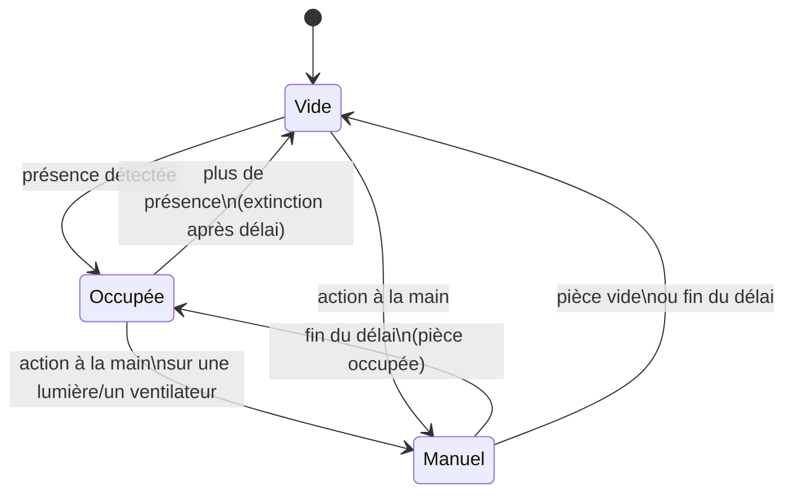

# Lumina

Intégration Home Assistant de gestion automatique des lumières et ventilateurs **par pièce**, avec prise en compte de la présence, de la luminosité et de la température.

Chaque pièce est une entrée de configuration indépendante, ajoutée depuis l'interface : aucune automatisation à écrire ou à dupliquer.

## Fonctionnement



- **Lumières** : allumées à l'arrivée si la luminosité est sous le seuil (toujours, s'il n'y a pas de capteur de luminosité). Éteintes quand la pièce est vide depuis le délai réglé.
- **Ventilateurs** : allumés quand la pièce est occupée et que la température atteint le seuil, arrêtés 1 °C en dessous (hystérésis). Sans capteur de température, ils suivent simplement la présence.
- **Contrôle manuel** : allumer ou éteindre une lumière ou un ventilateur à la main suspend l'automatisme de ce groupe pendant la durée réglée. La reprise manuelle est levée dès que la pièce se vide.

Les lumières et ventilateurs peuvent aussi être des prises (`switch`), par exemple un ventilateur branché sur une prise Zigbee.

## Entités créées par pièce

| Entité | Rôle |
|---|---|
| `sensor.lumina_<pièce>_etat_de_la_piece` | Occupée / Vide / Contrôle manuel |
| `switch.…_gestion_auto_des_lumieres` | Active ou suspend l'automatisme des lumières |
| `switch.…_gestion_auto_des_ventilateurs` | Active ou suspend l'automatisme des ventilateurs |
| `number.…_seuil_de_luminosite` | Seuil en lx (défaut 50) |
| `number.…_seuil_de_temperature` | Seuil en °C (défaut 27) |
| `number.…_delai_d_extinction_des_lumieres` | En secondes (défaut 120) |
| `number.…_delai_d_arret_des_ventilateurs` | En secondes (défaut 300) |
| `number.…_duree_du_controle_manuel` | En minutes (défaut 30, 0 pour désactiver) |

Les réglages n'apparaissent que s'ils ont un sens pour la pièce (pas de seuil de luminosité sans capteur, etc.) et sont conservés au redémarrage.

## Installation

### Via HACS (recommandé)

1. HACS → menu ⋮ → **Dépôts personnalisés**.
2. Ajouter `https://github.com/phabrys/lumina`, catégorie **Intégration**.
3. Installer **Lumina**, puis redémarrer Home Assistant.

### Manuelle

Copier `custom_components/lumina` dans le dossier `custom_components` de la configuration Home Assistant, puis redémarrer.

## Ajouter une pièce

**Paramètres → Appareils et services → Ajouter une intégration → Lumina**, puis choisir la pièce. Les capteurs de présence, lumières, ventilateurs et capteurs de luminosité/température rattachés à la pièce sont proposés automatiquement. Les entités se modifient ensuite via **Configurer**.

Pour que la détection automatique fonctionne, chaque entité (ou son appareil) doit être rattachée à la bonne pièce dans Home Assistant.

## Développement

```bash
pip install -r requirements_test.txt
pytest
```
