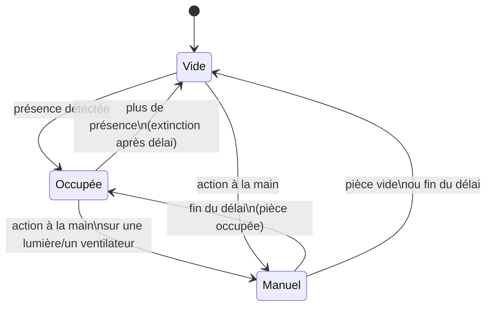

# Lumina

Intégration Home Assistant de gestion automatique des lumières et ventilateurs **par pièce**, avec prise en compte de la présence, de la luminosité et de la température.

Chaque pièce est une entrée de configuration indépendante, ajoutée depuis l'interface : aucune automatisation à écrire ou à dupliquer.

## Fonctionnement



- **Lumières** : allumées à l'arrivée si la luminosité est sous le seuil (toujours, s'il n'y a pas de capteur de luminosité). Éteintes quand la pièce est vide depuis le délai réglé.
- **Ventilateurs** : allumés quand la pièce est occupée et que la température atteint le seuil, arrêtés 1 °C en dessous (hystérésis). Sans capteur de température, ils suivent simplement la présence.
- **Contrôle manuel** : allumer ou éteindre une lumière ou un ventilateur à la main suspend l'automatisme de ce groupe pendant la durée réglée. La reprise manuelle est levée dès que la pièce se vide.

### Mode nuit

Chaque pièce a sa propre plage de nuit (22 h → 7 h par défaut) avec ses réglages dédiés :

- **Luminosité des lumières** : 30 % la nuit, 100 % le jour par défaut. À **0 %**, les lumières ne s'allument plus automatiquement la nuit (pratique dans une chambre d'enfants).
- **Délais d'extinction** propres à la nuit. Celui des ventilateurs est long par défaut (30 min), car un détecteur PIR ne voit pas une personne endormie immobile.
- **Seuil de température** de nuit (26 °C par défaut).

Mettre la même heure en début et en fin de nuit désactive le mode nuit pour la pièce. La période en cours (jour/nuit) apparaît en attribut du capteur d'état.

Le switch **Nuit maintenant** force le mode nuit tout de suite ; il se désactive seul à la fin de la prochaine nuit.

### Confort

- **Maintien de présence** : une TV, une enceinte ou une clim active garde la pièce occupée quand les détecteurs ne voient plus personne (devant la TV sans bouger, par exemple). Le maintien prolonge une présence, il ne la déclenche pas.
- **Température ressentie** : avec un capteur d'humidité, les ventilateurs suivent l'indice de chaleur (NOAA) plutôt que la température mesurée. 27 °C à 85 % d'humidité se ressentent comme 30 °C.
- **Vitesse progressive** : les ventilateurs démarrent à la vitesse minimale (33 %) au seuil, puis montent jusqu'à 100 % sur l'écart réglé (3 °C). Une vitesse minimale à 0 revient au simple marche/arrêt. Changer la vitesse à la main compte comme une reprise manuelle.
- **Avertissement avant extinction** : les lumières baissent à 20 % pendant 15 s avant de s'éteindre. Un mouvement pendant ce temps rétablit la lumière.
- **Teinte** : 4000 K le jour, 2700 K la nuit, pour les lumières à blanc réglable (0 = ne pas modifier).
- **Journal** : chaque décision apparaît dans le Journal avec sa raison, par exemple « allume les lumières à 30 % (nuit, 12 lx) ».

Les lumières et ventilateurs peuvent aussi être des prises (`switch`), par exemple un ventilateur branché sur une prise Zigbee.

## Entités créées par pièce

| Entité | Rôle |
|---|---|
| `sensor.lumina_<pièce>_etat_de_la_piece` | Occupée / Vide / Contrôle manuel |
| `switch.…_gestion_auto_des_lumieres` | Active ou suspend l'automatisme des lumières |
| `switch.…_gestion_auto_des_ventilateurs` | Active ou suspend l'automatisme des ventilateurs |
| `number.…_seuil_de_luminosite` | Seuil en lx (défaut 50) |
| `number.…_seuil_de_temperature` | Seuil en °C (défaut 27) |
| `number.…_delai_d_extinction_des_lumieres` | En secondes (défaut 120) |
| `number.…_delai_d_arret_des_ventilateurs` | En secondes (défaut 300) |
| `number.…_duree_du_controle_manuel` | En minutes (défaut 30, 0 pour désactiver) |
| `number.…_luminosite_des_lumieres_jour` | En % (défaut 100) |
| `time.…_debut_de_la_nuit` / `time.…_fin_de_la_nuit` | Plage de nuit (défaut 22:00 → 07:00) |
| `number.…_luminosite_des_lumieres_nuit` | En % (défaut 30, 0 = pas d'allumage la nuit) |
| `number.…_delai_d_extinction_des_lumieres_nuit` | En secondes (défaut 60) |
| `number.…_delai_d_arret_des_ventilateurs_nuit` | En secondes (défaut 1800) |
| `number.…_seuil_de_temperature_nuit` | En °C (défaut 26) |
| `switch.…_nuit_maintenant` | Force le mode nuit jusqu'à la fin de la prochaine nuit |
| `sensor.…_temperature_ressentie` | Indice de chaleur (si un capteur d'humidité est choisi) |
| `number.…_vitesse_minimale_des_ventilateurs` | En % (défaut 33, 0 = marche/arrêt) |
| `number.…_ecart_pour_la_vitesse_maximale` | En °C (défaut 3) |
| `number.…_avertissement_avant_extinction` | En secondes (défaut 15, 0 = extinction directe) |
| `number.…_teinte_des_lumieres_jour` / `…_nuit` | En K (défaut 4000 / 2700, 0 = ne pas modifier) |

Les réglages n'apparaissent que s'ils ont un sens pour la pièce (pas de seuil de luminosité sans capteur, etc.) et sont conservés au redémarrage.

## Installation

### Via HACS (recommandé)

1. HACS → menu ⋮ → **Dépôts personnalisés**.
2. Ajouter `https://github.com/phabrys/lumina`, catégorie **Intégration**.
3. Installer **Lumina**, puis redémarrer Home Assistant.

### Manuelle

Copier `custom_components/lumina` dans le dossier `custom_components` de la configuration Home Assistant, puis redémarrer.

## Ajouter une pièce

**Paramètres → Appareils et services → Ajouter une intégration → Lumina**, puis choisir la pièce. Les capteurs de présence, lumières, ventilateurs et capteurs de luminosité/température rattachés à la pièce sont proposés automatiquement. Les entités se modifient ensuite via **Configurer**.

Pour que la détection automatique fonctionne, chaque entité (ou son appareil) doit être rattachée à la bonne pièce dans Home Assistant.

## Développement

```bash
pip install -r requirements_test.txt
pytest
```
